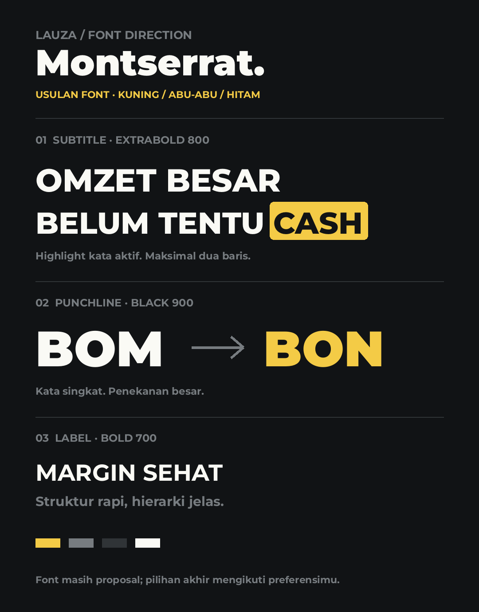

# Lauza Clipper

Reusable skill and visual kit for short podcast edits. Yellow / gray / charcoal
is the approved identity; Montserrat is a proposed replacement for Fira Sans.
This is a workflow kit, not a runnable video editor or a complete Remotion project.

- [Skill entrypoint](SKILL.md)
- [Brand tokens](brand.json)
- [Visual direction](references/visual.md)
- [Tools and source references](references/toolchain.md)
- [Example job contract](templates/plan.json)
- [Antigravity GitHub publishing prompt](PROMPT-ANTIGRAVITY.md)

Copy this folder to your agent's skill directory, or point the agent at
`SKILL.md`. For Codex, `~/.codex/skills/lauza-clipper/SKILL.md` is a conventional
installation path; project-local discovery can use `.agents/skills/lauza-clipper`.
Invoke `$lauza-clipper`, or ask the agent to read this skill before a Lauza clipper task.
On another machine, resolve relative assets from this folder and install the
production tools separately. Do not copy absolute paths from previous job files.

The entrypoint records the unresolved Timothy synchronization issue so future
jobs validate real lip sync before adding a finished animation treatment.

Montserrat assets are unmodified and carry their original
[SIL Open Font License](assets/fonts/OFL.txt). Attribution and the project URL
are retained there. User learning documents and third-party skills are referenced,
not redistributed. This package does not assign a license to the user's other work.
